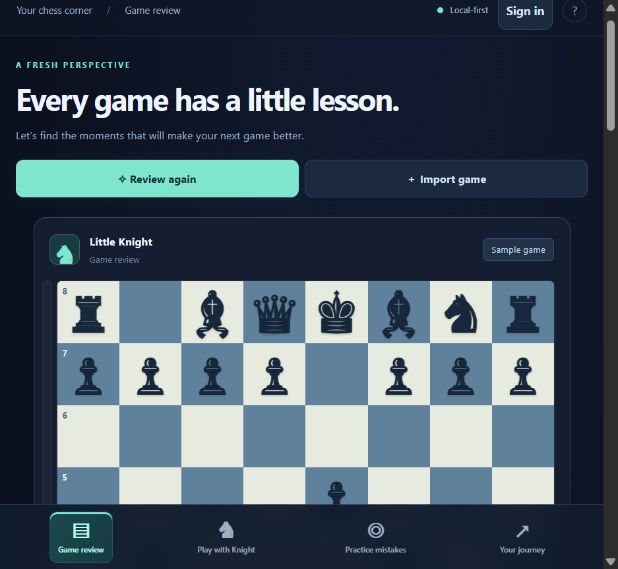
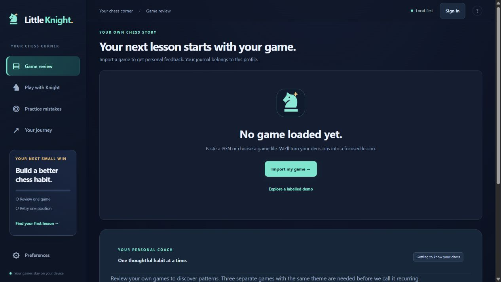

# Little Knight ♞

**Turn your own chess mistakes into your next lesson.**

A local-first chess analysis website and offline Windows companion. Little Knight combines Stockfish 18 with understandable feedback, guided retries, and practice based on patterns in your own games.

**[Try the live website](https://little-knight-chess.pages.dev/)** · [Deployment](docs/DEPLOYMENT.md) · [Architecture](docs/ARCHITECTURE.md)

> Development preview. Coaching is deterministic and engine-grounded, not an unrestricted AI chatbot. Email/password accounts are beta. Payments are disabled.



## Features

- **Your own games:** paste PGN or import a file, including custom starting positions. New profiles start empty; the demo is opt-in. Returning profiles reopen their own last game.
- **Understand a turning point:** predict the reply, reveal an explanation, step through a continuation, and retry the position.
- **Personal coaching:** count themes across up to 20 distinct analysed games. Three games with a theme are needed before it is labelled recurring.
- **Spaced practice:** save important positions, use escalating hints, and revisit them later. Guided answers are not counted as independent recall.
- **Friendly play:** adjustable practice opponents, promotions, takebacks, hints, and contextual dialogue.
- **Local memory:** saved games, lessons and preferences; validated backup export/restore.
- **Optional accounts:** email/password login with separate local journals. Guest mode remains available; accounts do not sync games across devices.
- **Offline chess:** practice assets cache on first visit. Full analysis downloads approximately 108 MiB once and caches when storage permits. The Windows package includes both engines.



## Quick start

Requires **Node.js 24+** and npm. Windows x64 is the packaged desktop target; the website runs in modern browsers with WebAssembly support.

```sh
git clone https://github.com/keyisthelock/little-knight.git
cd little-knight
npm ci
npm run build
npm test
npm run dev
```

Open **http://127.0.0.1:4173**. This static development server supports chess features. Authentication needs the Cloudflare Worker and D1 setup in the [deployment guide](docs/DEPLOYMENT.md).

The corresponding Stockfish source archive and notices are included. To regenerate them, run `node scripts/verify-engine-source.mjs` before building; it downloads the official tagged source and records SHA-256 checksums.

### Windows desktop

```sh
npm run build
npm run desktop
npm run package:desktop
```

Open `release/Little Knight/Little Knight.exe` and keep the whole folder together. Progress lives in `LocalProfile` beside the executable. Export a backup before replacing the app. Desktop and browser journals are separate.

Electron normally downloads during `npm ci`. If skipped, `node scripts/download-electron.mjs` downloads and verifies the official Windows archive; extract it into `node_modules/electron/dist` before packaging. Close the app before replacing runtime files.

The Windows development build is unsigned. It needs no administrator privileges, startup service, camera, microphone, or local network server. Login is a feature of the HTTPS website; offline chess needs no account.

## Technology

| Layer | Implementation |
| --- | --- |
| Interface | HTML, CSS, plain JavaScript, esbuild |
| Rules | chess.js 1.4.0 |
| Analysis | Stockfish.js 18.0.8 / Stockfish 18; C++ compiled to WebAssembly |
| Teaching | Deterministic explanations from legal engine lines and evaluation changes |
| History | Account-partitioned localStorage; JSON backup/restore |
| Accounts | Cloudflare Pages Worker, D1 SQLite, secure session cookies |
| Desktop | Electron, sandboxed renderer and isolated local asset protocol |

One worker runs at a time, with **one engine thread and a 32 MiB hash**. Hash size is not total application memory. Reviews use 0.3, 1, or 3 seconds per position. Friendly practice uses Lite at 200 ms per move; the full-strength opponent uses the full engine.

## How teaching works

1. Analyse legal positions before and after each move with Stockfish.
2. Measure evaluation loss from the moving side's perspective.
3. Replay legal continuations to support a lesson: king safety, missed mating chances, piece safety, forcing moves, or general calculation.
4. Ask the user to predict a reply before revealing the explanation, then compare lines and retry.
5. Store lesson tags once per distinct game; repeated analysis cannot inflate habit counts.
6. Schedule retries from attempts, hint use and independent successes.

The explanations deliberately stay within observable evidence. They cannot infer emotions, time pressure, or understanding. Short engine lines do not prove that every alternative loses. Practice currently targets the saved first choice and may reject another reasonable move.

## Project structure

```text
src/
  app.js          Board, UI, review and practice flows
  core.js         PGN parsing, review calculations, profile validation
  coach.js        Explanations, habits, spaced practice
  account.js      Sign-in UI and same-origin requests
  engine.js       Stockfish worker lifecycle and UCI
  style.css       Responsive design
server/
  worker.js       Account API and static-asset delegation
  schema.sql      Accounts, sessions, rate counters
public/           Offline worker, notices, matching engine source
desktop/          Electron shell
scripts/          Build, preview, packaging, verification
tests/            Chess, coaching, account and real-engine checks
docs/             Deployment, architecture, screenshots
```

## Verification

`npm test` currently runs **18 checks**: real engine evaluations and switching, exact WASM reconstruction, PGN validation, score perspective, legal teaching lines, distinct-game habits, hint-aware scheduling, backups, and authentication integration against real SQLite.

The deployed account service was smoke-tested for guest access, registration, authenticated session lookup, wrong passwords, login and logout. Browser checks covered a fresh profile's empty review, the login form, a completed full-engine review, explanation reveal, continuation stepping, and guided practice. These checks are not a security audit or evidence of learning outcomes.

`node scripts/smoke-auth.mjs` is an optional live check. It creates a randomly named QA account under `example.invalid`, sends no email, and prints no passwords or tokens. Do not run it routinely against production.

## Accounts and privacy

Games stay on the device. Optional accounts store an email, salted password hash, hashed session tokens, and temporary anti-abuse counters in Cloudflare D1. Sessions use Secure/HttpOnly/SameSite cookies and expire after 24 hours. The API uses origin checks, prepared SQL, bounded bodies, and per-IP/email attempt limits. Passwords are not persisted in browser storage.

**Account beta limitations:** email verification, password recovery, self-service account deletion and cloud history sync are not implemented. Local journals are not encrypted against someone with access to the browser profile. PBKDF2 currently uses Cloudflare Web Crypto's 100,000-iteration ceiling; revisit the authentication design and obtain a security review before commercial launch.

There are no ad trackers, cloud chatbot calls, camera or microphone features. Ordinary hosting requests still reach Cloudflare. Browser storage may be cleared or evicted; keep backups.

## Product limits

- The playful rating guess is an **uncalibrated formula**, not a trained model or official rating. Its displayed range is not a statistical confidence interval.
- Move quality is a custom evaluation-loss index. Short searches and classification thresholds are approximate.
- Engine strength does not guarantee clear teaching or rating gains.
- Skill-limited practice is not a calibrated human-like opponent.
- Memory is saved data and rule-based selection, not neural training or personality learning.
- The original 48-game benchmark estimated the easy bot near 1679 on its experimental reference scale. It did not rate the full engine or establish a human-platform Elo. No 3500-Elo guarantee is made.
- Pricing remains exploratory; no checkout or paid entitlement system is enabled.

## Roadmap

- Review explanations with experienced chess teachers and beginner testers.
- Accept multiple good practice answers through fresh engine evaluation.
- Measure learning and retention over repeat sessions.
- Add verified email, recovery, deletion and audited authentication.
- Consider opt-in history syncing and a small offline language model after measuring memory and response quality.
- Add signed desktop updates and payments after the core experience proves useful.

## Licences and credits

Stockfish.js is GPLv3; chess.js is BSD-2-Clause. Matching Stockfish source, build scripts, licence text, and checksums live under `public/engine-source/` and are linked from the app's credits page. Engine JS/WASM bytes are unmodified; full WASM is split into files of at most 16 MiB and reassembled before use. Electron/Chromium notices stay in the desktop distribution.

See [third-party notices](public/licenses.html). This repository does not declare an open-source licence for the original application code; public visibility alone does not grant additional rights. Third-party components retain their own licences.
